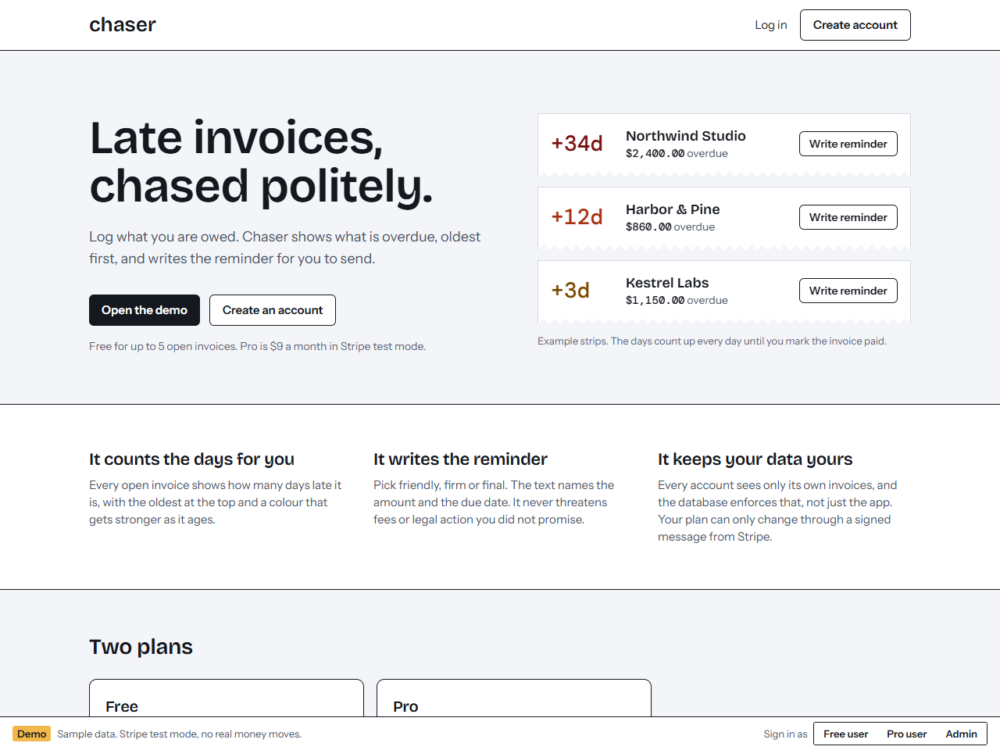
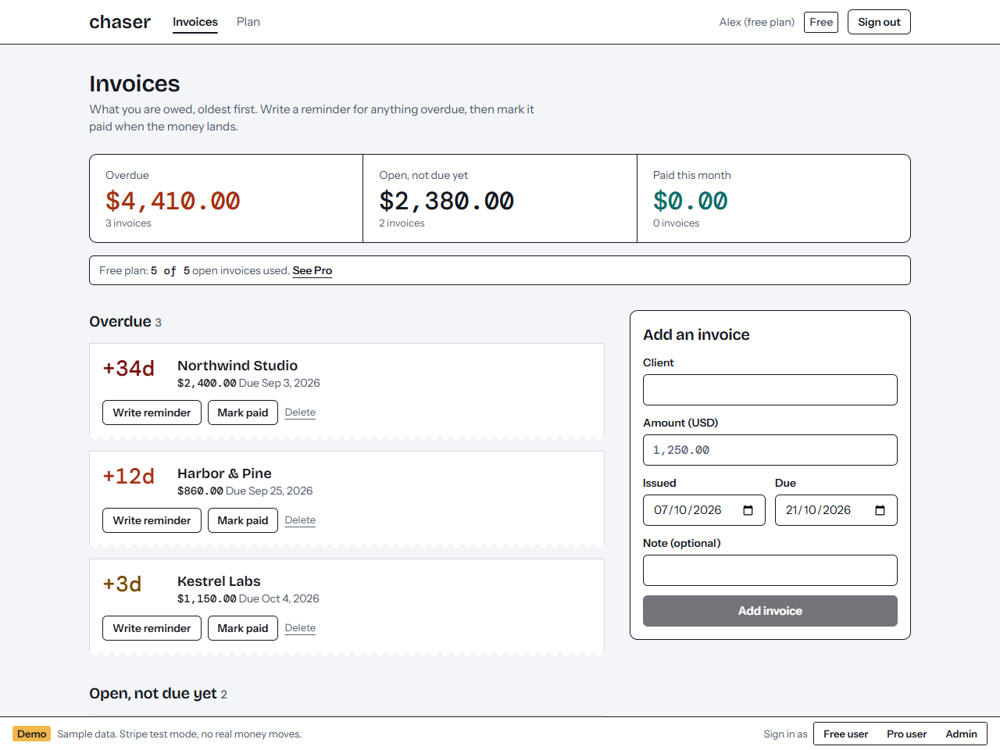
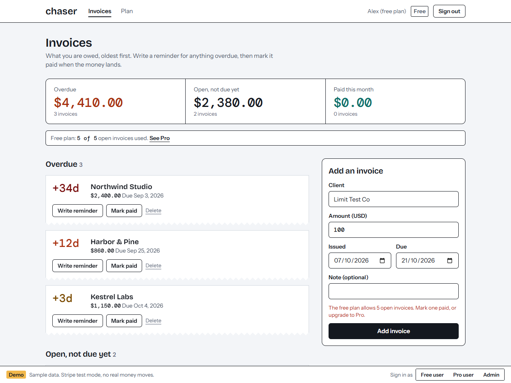
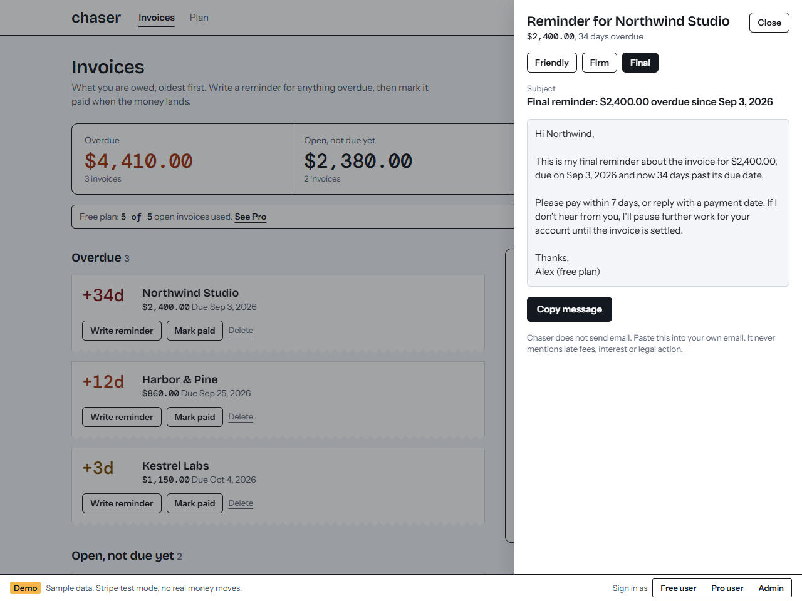
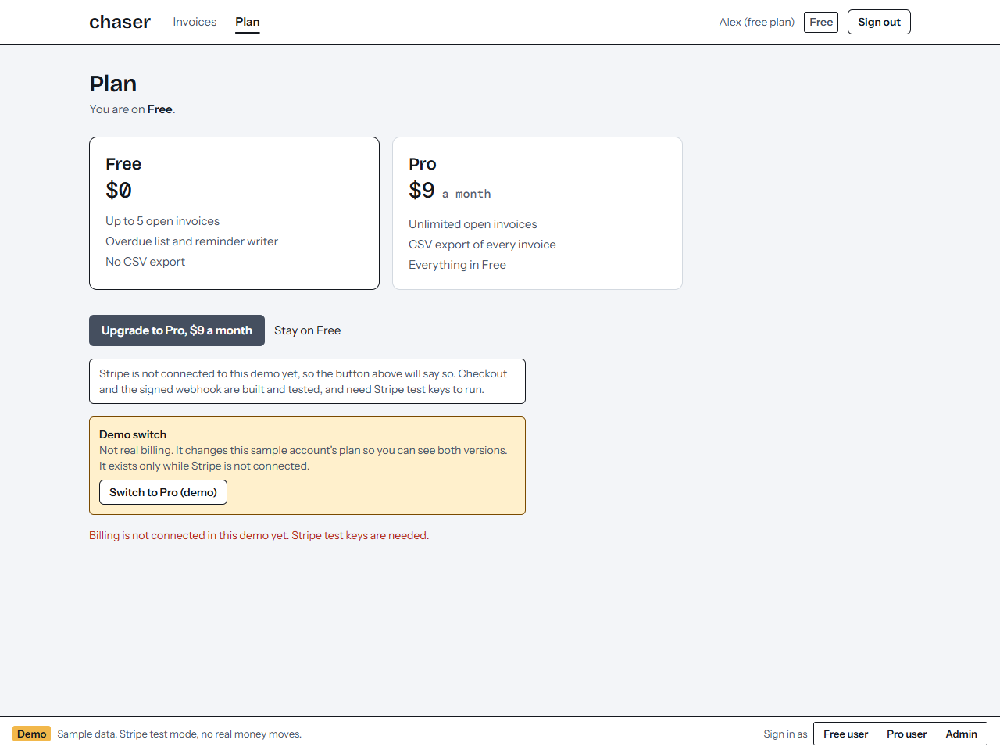
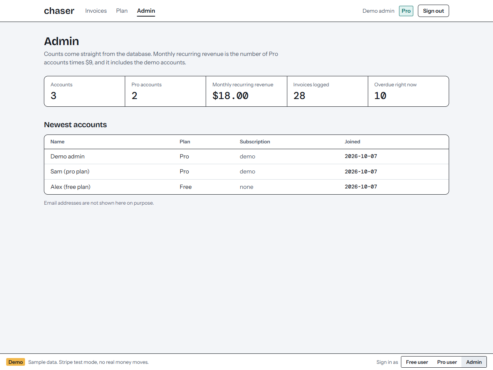

# Chaser: late invoices, chased politely

A small subscription app for freelancers. Log what you are owed, see what is overdue (oldest first, with the days counted), and get a polite reminder written for you to send. There is a Free plan (5 open invoices) and a Pro plan ($9 a month, Stripe test mode) with unlimited invoices and CSV export.

This is a demo. All clients and invoices are sample data, and Stripe is in test mode.

## Screenshots

## What it does
- **Overdue list.** Open invoices sorted by how late they are, with a colour that gets stronger as they age. Paid invoices move out of the way.
- **Reminder writer.** Friendly, firm or final, picked for you by how late the invoice is. The text names the amount and due date and never mentions late fees, interest or legal action, because the sender never promised any. It does not send email: you copy it.
- **Plans.** Free allows 5 open invoices. Pro removes the limit and adds CSV export.
- **Admin.** Accounts, Pro accounts, monthly recurring revenue (Pro accounts times $9), invoices and overdue count, from real rows. No email addresses are shown.

## How the security works
- **Row-level security on every table.** A signed-in user reaches only their own invoices and profile. The public key can read and write nothing.
- **Plans cannot be self-assigned.** Users can update only their display name. The plan and Stripe columns have no update privilege for users, and the only code that changes them is the signed Stripe webhook (and, in demo mode with no Stripe keys, a clearly labelled demo switch).
- **The free-plan limit lives in the database** as a trigger, so no client or API call can get past it. The API only turns the database error into a clear message.
- **The webhook** checks Stripe's signature on the raw body, applies each event once (event ids are claimed in a table, and released if applying fails so Stripe's retry works), and refuses to run with a placeholder secret.
- **Test keys only.** A live Stripe key is refused on purpose.
- **Writes check the request origin**, ids are validated before they reach the database, and input is validated by type and range, not coerced.
- **CSV export** neutralizes spreadsheet formulas in client names.
- **The cron route** answers 401 unless `CRON_SECRET` is set to a real value (the string `undefined` is not accepted).

## What is verified
- `npm test`: 36 tests. Overdue maths across month ends and leap years, money parsing, reminder text for each tone, CSV quoting and formula safety, input validation, the plan rules, webhook signatures (forged, missing, wrong secret, tampered body, placeholder secret), plan changes from each event type, idempotency including retry after a failure, and the guards on every API route.
- `npm run check:isolation`: 29 checks against the real database, using the public key and two ordinary users. It proves that user B cannot read, change, delete or forge user A's invoices, that nobody can upgrade themselves, set Stripe ids or become admin, and that the free-plan limit holds (and releases when an invoice is marked paid). Weakening the database makes four of these fail, so the checks do detect problems.
- An end-to-end run in a real browser through the click path: open the demo, hit the free limit, write a reminder, mark paid, add the invoice, view billing, switch to Pro, export a CSV, be refused as a regular user on the admin page, sign out.

## What is NOT verified
- **Live Stripe Checkout and the live webhook.** They are built and the logic is tested with signed test events, but no Stripe test keys were available, so no real checkout was completed. Add keys and a webhook endpoint (steps below) and try one.
- Reminders are text only. Sending email is out of scope.
- Signup skips email confirmation so the demo works without an email provider. It is rate limited site-wide.

## Setup
1. `npm install`
2. Create a Supabase project and run `supabase/schema.sql` in the SQL editor.
3. Copy `.env.example` to `.env.local` and fill it in.
4. `npm run seed` creates three sample users (free, pro, admin) and fictional invoices dated relative to today.
5. `npm run dev`

### Turning on Stripe (test mode)
1. In the Stripe dashboard (test mode), copy the secret key into `STRIPE_SECRET_KEY`.
2. Add a webhook endpoint at `/api/stripe/webhook` for `checkout.session.completed`, `customer.subscription.updated`, `customer.subscription.deleted` and `invoice.payment_failed`, and copy its signing secret into `STRIPE_WEBHOOK_SECRET`. Locally: `stripe listen --forward-to localhost:3000/api/stripe/webhook`.
3. With real test keys set, the demo "Switch to Pro" button disappears, and the only way to become Pro is a completed Checkout confirmed by the webhook. Use card `4242 4242 4242 4242`.

## Environment
| Variable | Purpose |
|---|---|
| `NEXT_PUBLIC_SUPABASE_URL`, `NEXT_PUBLIC_SUPABASE_ANON_KEY`, `SUPABASE_SERVICE_ROLE_KEY` | Database. The service key is server-only. |
| `DEMO_MODE=true` | Shows the demo bar and enables one-click sample sign-in. Only for deployments that hold sample data. |
| `DEMO_PASSWORD` | Password of the sample users (12+ characters). Used by the seed script and the demo sign-in. |
| `STRIPE_SECRET_KEY`, `STRIPE_WEBHOOK_SECRET` | Stripe test mode. Placeholders mean billing is off. |
| `NEXT_PUBLIC_APP_URL` | Used for Checkout return links. |
| `CRON_SECRET` | Authorizes the daily maintenance job. Without it the job answers 401. |

## Stack
Next.js 14 (App Router, TypeScript), Tailwind, Supabase (Postgres and auth), Stripe, Vercel Cron.

## License
MIT
